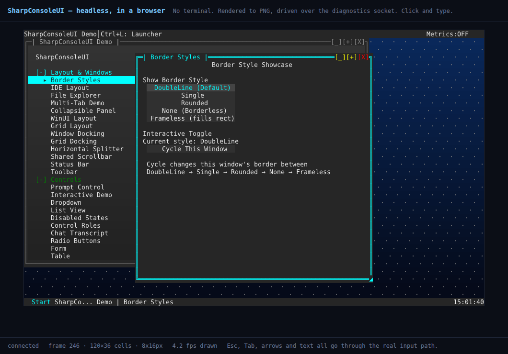

# WebHost — a terminal UI in a browser, with no terminal

Runs **DemoApp**, unmodified, on `HeadlessConsoleDriver`, renders each frame to PNG, and
serves it to a browser. Clicks and keystrokes come back as real input.



That is a browser window. Both windows inside it were opened by clicking, and there is no
terminal anywhere in the process.

```bash
dotnet run --project Examples/WebHost
# then open http://127.0.0.1:5088
```

> **Local only.** The server binds to `127.0.0.1` deliberately. Anyone who can reach it has
> full control of the application, not just a view of it — see [Security](#security).

---

## What it demonstrates

The application is **the same code that runs in a terminal**. DemoApp is not adapted, not
reimplemented, and not aware it has no terminal:

```csharp
using var app = new HeadlessApp(
    Columns, Rows,
    DemoApp.Program.CreateOptions(),            // panels: status bar, Start menu, taskbar, clock
    ws => DemoApp.Program.Configure(ws, args)); // background, settings, launcher, shortcuts
```

Those two methods are the ones `DemoApp.Main` itself calls. Only the driver and the loop
differ.

The web layer reaches the application **only through its diagnostics socket**. It holds no
reference to the window system, the driver or any control — everything it knows arrives as
JSON. The same host code would work unchanged against an application in another process that
someone else started.

---

## Why headless is required

Not a convenience. Three things depend on it:

- **Nothing else owns the terminal.** A real driver holds raw mode, the alternate screen and
  stdin. A browser cannot drive input while a tty is also holding it.
- **`size` works.** `NetConsoleDriver.ScreenSize` is read-only, owned by the terminal.
  Headless, the browser can set the application's dimensions — which makes it a frontend
  rather than a viewer.
- **It runs anywhere.** A container, a service, CI. No pty required.

---

## How it fits together

```
browser  ──HTTP──▶  WebHost  ──unix socket──▶  DemoApp on HeadlessConsoleDriver
                                                (RunInBackground, own thread)
```

| File | Does |
|---|---|
| `HeadlessApp.cs` | Owns the UI thread: builds the system, runs `Tick()`, opens the socket |
| `DiagnosticsClient.cs` | One pooled socket connection, one request/reply at a time |
| `Program.cs` | HTTP endpoints, and the browser-event → socket-verb translation |
| `wwwroot/index.html` | Canvas, polling loop, input handlers, pixel→cell arithmetic |

`RunInBackground()` gives the loop its own thread and returns once a frame has rendered, so
ASP.NET keeps the thread it needs and the socket is live before the first request arrives.
The web layer still reaches the application only over the socket.

---

## Endpoints

### `GET /frame?since=<n>&cellHeight=<px>`

The composed desktop as a PNG.

```json
{"frame":1211,"width":960,"height":576,"cols":120,"rows":36,"cell":"8x16","png":"iVBOR..."}
{"unchanged":true,"frame":1204}
```

`since` is what makes polling cheap. A TUI is idle between keystrokes, so most polls answer
`unchanged` in a few bytes rather than re-sending an identical 34 KB image — and the
short-circuit happens before a font is loaded or a buffer touched.

### `POST /input`

```json
{"kind":"key","spec":"Down"}
{"kind":"mouse","x":43,"y":25,"action":"press","button":"left"}
{"kind":"mouse","x":48,"y":28,"action":"move","button":"left"}
{"kind":"mouse","x":48,"y":28,"action":"release","button":"left"}
{"kind":"resize","x":120,"y":36}
```

A click is sent as **press, release, click** - the clicked flag is its own event in the
library, not a press plus a release, and controls listen for it. A drag is **press, move,
release** with no click, and a double-click adds `doubleclick` after two complete click
sequences, matching the order a terminal reports them.

The gesture is sent as press, move, release rather than a single click, because a window
move, a resize, a text selection and a scrollbar thumb all need the whole gesture. `move`
and `release` are bound to the window, not the canvas, so a drag that leaves the canvas
keeps reporting and a release outside it still ends the drag — otherwise the application
would be left believing the button is still down. One event per cell crossed, since at 8x16
pixels a slow drag would otherwise send dozens of identical positions and starve the frame
polling.

The browser also **resizes the application** to fit its window, debounced, which only a
headless driver allows: a real terminal owns its own size.

Each becomes the matching socket verb and returns as soon as the event is queued. Nothing
waits for the UI: the page is already polling, so it sees the consequence on the next frame.
Everything goes through the same dispatch a real keypress or click takes, so hit-testing,
focus and z-order behave exactly as they would in a terminal.

---

## Pixel to cell

The reply carries `cell` (`"8x16"`), which is all the browser needs:

```js
const r = canvas.getBoundingClientRect();
const x = Math.floor((event.clientX - r.left) * (canvas.width / r.width) / cellW);
const y = Math.floor((event.clientY - r.top) * (canvas.height / r.height) / cellH);
```

The scale factor is not optional: a canvas displayed smaller than its natural size on a
narrow window sends every click to the wrong place without it.

Wide characters need no special handling here — pass cell coordinates through and the
library's own hit-testing resolves a click on the second column of a CJK glyph to the glyph.

---

## Keys

Browser key names are mapped to the tmux notation the socket speaks: `ArrowDown` → `Down`,
`C-` / `M-` / `S-` for ctrl, alt and shift, and a single printable character is sent quoted
so it is typed literally. An unrecognised name is rejected by the socket rather than typed,
so a gap in the mapping shows up as an error instead of garbage in a text box.

---

## Performance

Measured on a 120×40 desktop, which is what this serves:

| | per frame | ceiling |
|---|---|---|
| 16px cells | 38 ms, 34 KB | ~26 fps |
| 12px cells | 21 ms, 21 KB | ~47 fps |
| unchanged | — | ~29 bytes |

PNG compression dominates — `Glyphs=false` is not faster, so it is not the text rasterising.
Smaller cells are the real lever. The page polls at 10 fps, which is comfortable.

Two protocol additions would improve it, neither built:

- **`watch`** — a subscription that pushes a frame when one is ready, removing the
  poll-interval latency floor (a keystroke currently echoes after up to 100 ms even though
  the frame was ready in 2 ms). Needs a backpressure rule: drop intermediate frames, never
  queue them, because a stale frame has no value once a newer one exists.
- **Row-band deltas** — `png` returning only changed rows. Worth it only once a *busy*
  screen proves to be the bottleneck; `sinceFrame` already covers the idle case.

---

## Security

This turns a local socket into a network service, which inverts the socket's threat model.
Its consent prompt says "another program on this machine"; a web host makes it "anyone who
can reach this port".

- Binds to `127.0.0.1` only. Do not change this to `0.0.0.0` without putting real
  authentication in front of it.
- Grants **full control** of the application — keys, clicks, resize — not a read-only view.
- This is a demonstration of what the architecture makes possible, not a deployment pattern.

---

## See also

- [`DRIVERS.md`](../../docs/DRIVERS.md) — drivers and render modes, and running headless
- [`DEBUGGING.md`](../../docs/DEBUGGING.md) — the diagnostics socket and its verbs
- [`EXPORT.md`](../../docs/EXPORT.md) — the export API this uses to produce each frame
