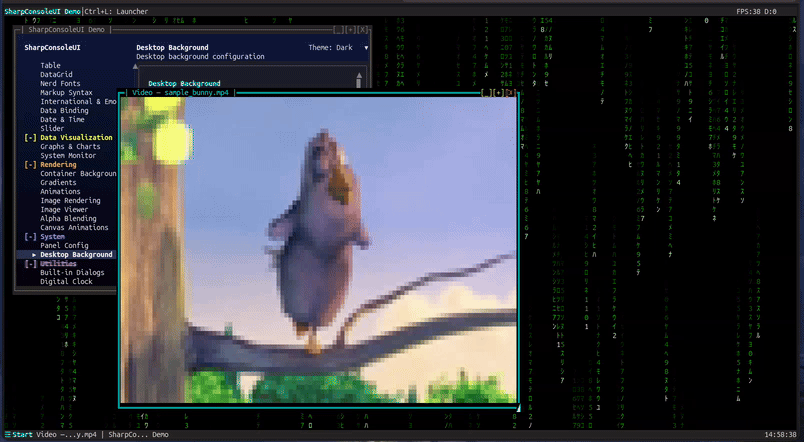
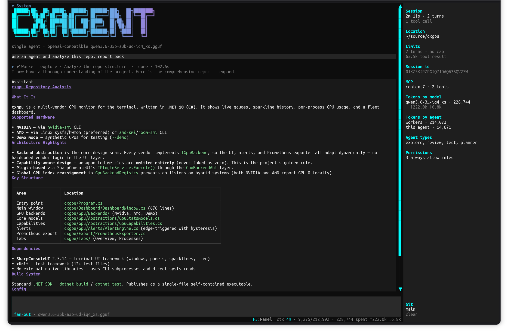
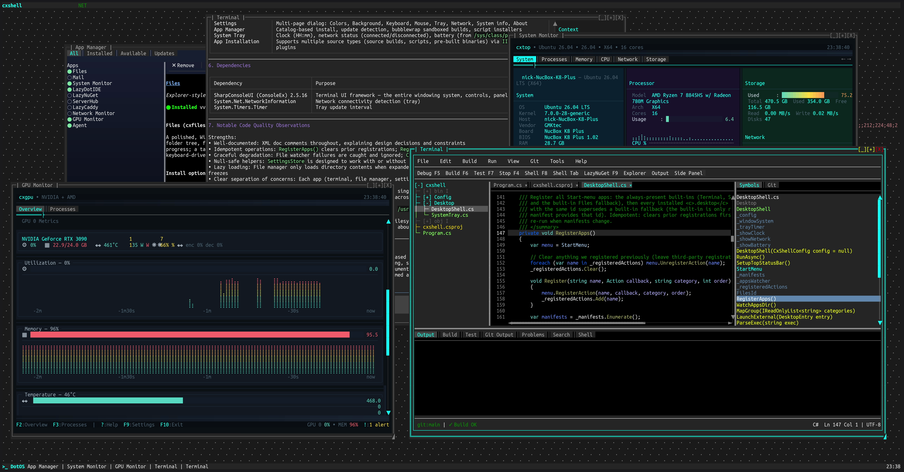
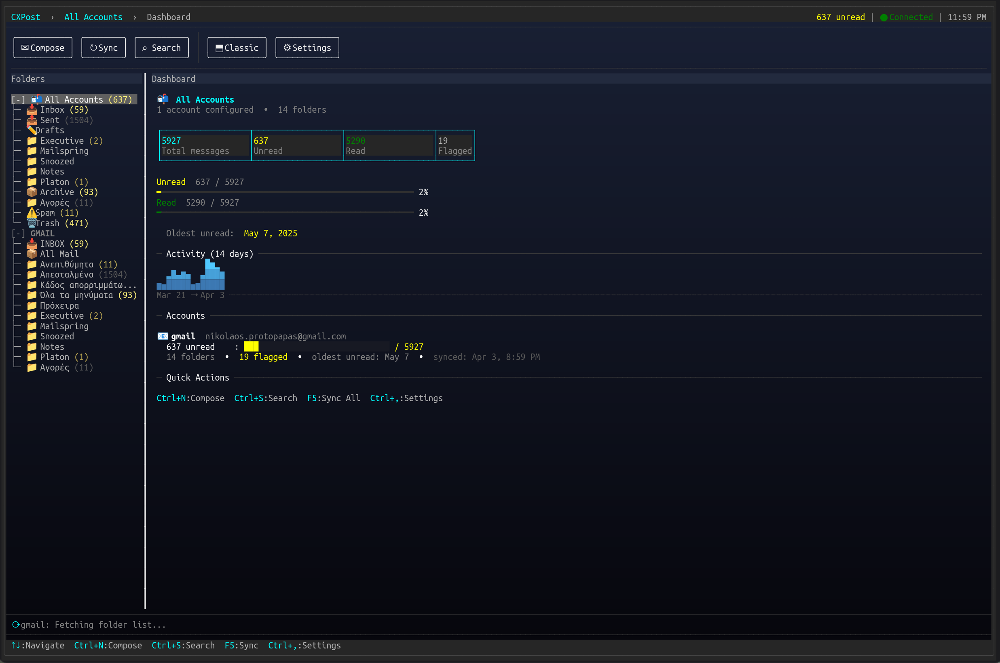
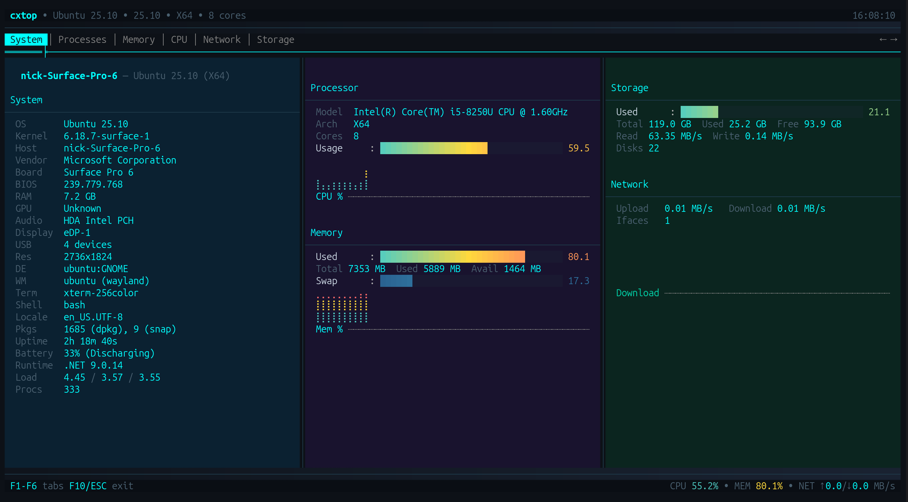
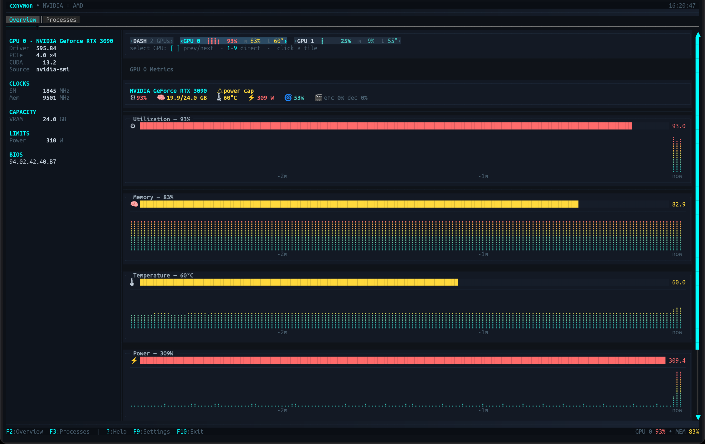
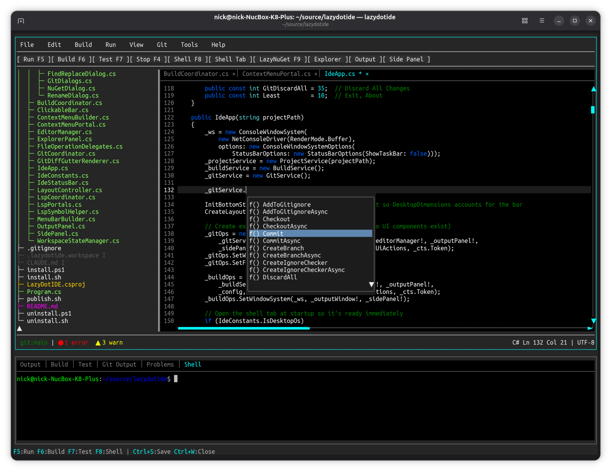
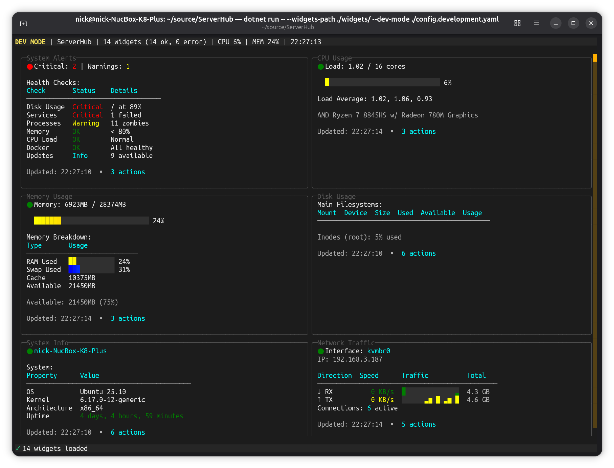
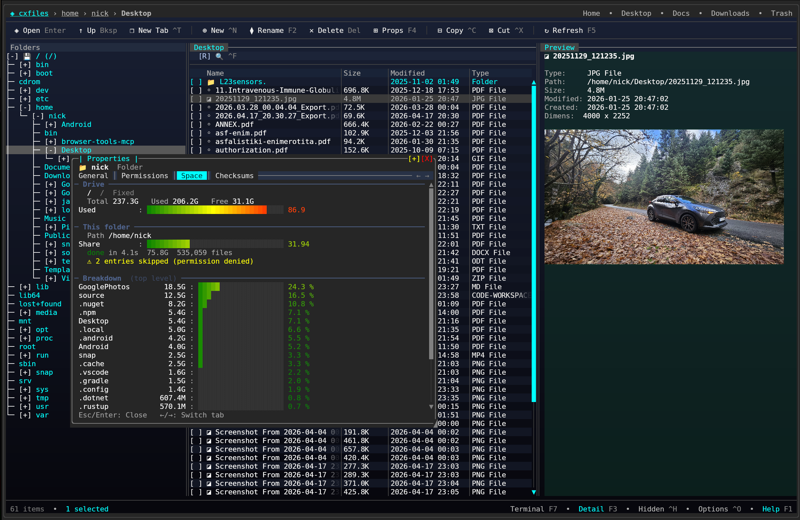
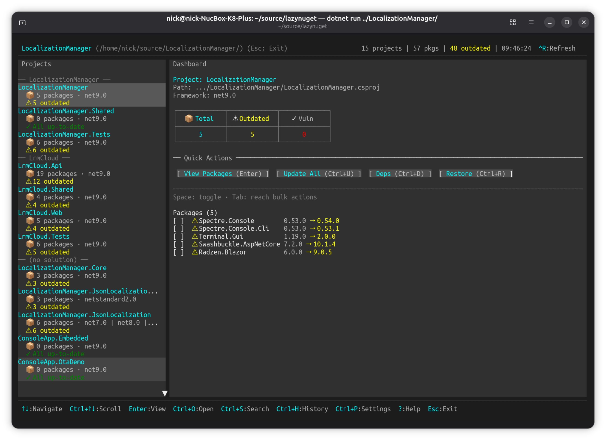

# SharpConsoleUI

<p align="center">
  
</p>

<p align="center">
  <a href="https://www.nuget.org/packages/SharpConsoleUI"></a>
  <a href="https://www.nuget.org/packages/SharpConsoleUI"></a>
  <a href="https://github.com/nickprotop/ConsoleEx/actions/workflows/code-quality.yml"></a>
  <a href="LICENSE.txt"></a>
  <a href="https://dotnet.microsoft.com"></a>
  <a href="docs/AOT.md"></a>
</p>

<p align="center">
  <a href="https://nickprotop.github.io/ConsoleEx/">Website</a> &nbsp;·&nbsp;
  <a href="https://nickprotop.github.io/ConsoleEx/docfx/_site/EXAMPLES.html">Examples</a> &nbsp;·&nbsp;
  <a href="https://nickprotop.github.io/ConsoleEx/docfx/_site/tutorials/README.html">Tutorials</a>
</p>

A Terminal Application Framework for .NET — the terminal, as an application surface.

Build complete applications with overlapping windows, a real compositor, and reactive
component UI, rendered efficiently to any modern terminal. (The runtime ships as the
`SharpConsoleUI` NuGet package.)

Each window runs on its own async thread, with built-in marshalling back to the UI
thread. A DOM-based layout engine measures, arranges, and paints a tree of controls,
including responsive panes and flexible grids with fixed, auto-sized, and proportional
tracks, spans, and splitters. The compositor merges per-window buffers with per-cell
alpha blending, so overlapping windows, animated backgrounds, and tween/easing
animations all composite cleanly. A portal system for dropdowns, overlays, and toast
notifications. 30+ controls (including an embedded PTY terminal that runs a real shell,
a video player, data tables, tree views, and markdown), a plugin architecture, and
NativeAOT-ready.



### Watch it run

| | |
|:---:|:---:|
| [](https://www.youtube.com/watch?v=LOH_yuFBHss)<br>**[cxshell — a desktop in the terminal](https://www.youtube.com/watch?v=LOH_yuFBHss)**<br>Start menu, taskbar, app manager, and other TUI apps running live inside its windows. | [](https://www.youtube.com/watch?v=Oz8Yo50GfOs)<br>**[DemoApp showcase](https://www.youtube.com/watch?v=Oz8Yo50GfOs)**<br>Windows, controls, markup, compositor effects and dialogs. |
| [](https://www.youtube.com/watch?v=4jStrJD_EFU)<br>**[Cratis Chronicle Workbench](https://www.youtube.com/watch?v=4jStrJD_EFU)**<br>A third-party product built on SharpConsoleUI. | [](https://www.youtube.com/watch?v=sl5C9jrJknM)<br>**[Examples in action](https://www.youtube.com/watch?v=sl5C9jrJknM)**<br>A walkthrough of the example projects. |

---

## What it is

SharpConsoleUI gives each window its own `CharacterBuffer`. A compositor merges
them — with occlusion culling, per-cell Porter-Duff alpha blending, and a
Measure→Arrange→Paint layout pipeline. Each window runs on its own async thread.
Gradient backgrounds propagate through every transparent control automatically.

Because rendering goes through a diff-based cell buffer rather than writing
directly to stdout, the output is equally clean over a local terminal or an
SSH connection — latency and flicker are determined by what actually changed,
not by a full-screen repaint.

This architecture makes things possible that other .NET terminal libraries
don't do: overlapping windows with drag/resize/minimize/maximize, animated
desktop backgrounds, a PTY-backed terminal emulator, video playback with Kitty
graphics + cell-based fallbacks, and compositor hooks for blur, fade, and custom
effects.

A running application can also be **inspected and driven from outside**, over a local
socket: read the screen as text or as a PNG, read what the layout engine believes, then send
real keys and clicks. The same application runs **headless**, with no terminal at all.
See [Debugging](docs/DEBUGGING.md).

It's also [NativeAOT-compatible](docs/AOT.md) — the full control set runs as a
self-contained native binary, verified on every push by a publish-and-run CI gate.

---

## Features

| Capability | Built on | More |
|---|---|---|
| Overlapping windows with drag, resize, minimize, maximize | Per-window buffers merged by a compositor | [Windows](docs/WINDOWS.md) |
| Transparent windows and translucent controls | Per-cell alpha blending between window buffers | [Alpha Blending](docs/ALPHA_BLENDING.md) |
| Blur, fade and custom post-processing | `PreBufferPaint` / `PostBufferPaint` hooks | [Compositor Effects](docs/COMPOSITOR_EFFECTS.md) |
| Hidden regions cost nothing to render | Occlusion culling in the compositor | [Rendering Pipeline](docs/RENDERING_PIPELINE.md) |
| Dropdowns and overlays that escape their window | Portal system | [Portals](docs/PORTAL_SYSTEM.md) |
| Per-window async threads | A UI thread model with marshalling | [Threading & Async](docs/THREADING_AND_ASYNC.md) |
| A real shell running inside a control | PTY-backed terminal emulator | [Examples](docs/EXAMPLES.md) |
| Video playback, not still frames | Kitty graphics with cell-based fallback | [Video Playback](docs/VIDEO_PLAYBACK.md) |
| Animated desktop backgrounds | Gradient and pattern compositing | [Desktop Background](docs/DESKTOP_BACKGROUND.md) |
| Themes, controls, windows and services as plugins | Plugin architecture | [Plugins](docs/PLUGINS.md) |
| The composed desktop is a buffer, not a stream of escapes | `ConsoleBuffer` sits between the compositor and the device, so the app never writes to a terminal directly | [Rendering Pipeline](docs/RENDERING_PIPELINE.md) |
| Anything that accepts cells can be the display | `IConsoleDriver` — a terminal, a headless buffer, or a browser canvas | [Drivers](docs/DRIVERS.md) · [WebHost](Examples/WebHost/README.md) |
| The same app with no terminal at all | Headless driver + a hosted or background loop | [Drivers](docs/DRIVERS.md) |
| Inspect and drive a running app from outside | Diagnostics socket — text, PNG, layout tree, real input | [Debugging](docs/DEBUGGING.md) |
| Export a window, a region or the desktop | `ICellSurface` → PNG, TGA, JPEG, ANSI or markup | [Screen Export](docs/EXPORT.md) |

Alpha blending is **not** a unique feature: XenoAtom.Terminal.UI also does RGBA blending, in
linear colour space. What differs is where it happens — we blend *between per-window buffers*
during compositing, which is what makes overlapping translucent windows and compositor effects
possible. See the [full comparison](https://nickprotop.github.io/ConsoleEx/docfx/_site/COMPARISON.html)
for an honest side-by-side with Terminal.Gui, Spectre.Console and XenoAtom.Terminal.UI.

---

## Requirements

| Platform | Minimum version |
|----------|----------------|
| **.NET** | 8.0 or later |
| **Windows** | Windows 10 (1511+) / Server 2016+ |
| **Linux** | Any modern distribution with a terminal supporting 24-bit color |
| **macOS** | macOS 10.15+ |

---

## Quick start
```shell
dotnet add package SharpConsoleUI
```
```csharp
using SharpConsoleUI;
using SharpConsoleUI.Builders;
using SharpConsoleUI.Drivers;
using SharpConsoleUI.Panel;

var windowSystem = new ConsoleWindowSystem(
    new NetConsoleDriver(RenderMode.Buffer),
    options: new ConsoleWindowSystemOptions(
        BottomPanelConfig: panel => panel
            .Left(Elements.StartMenu())
            .Center(Elements.TaskBar())
            .Right(Elements.Clock())
    ));

var window = new WindowBuilder(windowSystem)
    .WithTitle("Hello")
    .WithSize(60, 20)
    .Centered()
    .WithBackgroundGradient(
        ColorGradient.FromColors(new Color(0, 20, 60), new Color(0, 5, 20)),
        GradientDirection.Vertical)
    .Build();

window.AddControl(Controls.Markup()
    .AddLine("[bold cyan]Real compositor. Full alpha blending.[/]")
    .AddLine("[#FF000080]This text has 50% alpha — composited over the gradient.[/]")
    .Build());

windowSystem.AddWindow(window);
windowSystem.Run();
```

Each window can run with its own async thread:

```csharp
var clockWindow = new WindowBuilder(windowSystem)
    .WithTitle("Digital Clock")
    .WithSize(40, 12)
    .WithAsyncWindowThread(async (window, ct) =>
    {
        while (!ct.IsCancellationRequested)
        {
            var time = window.FindControl<MarkupControl>("time");
            time?.SetContent(new List<string> { $"[bold cyan]{DateTime.Now:HH:mm:ss}[/]" });
            await Task.Delay(1000, ct);
        }
    })
    .Build();
```

### Project templates

```bash
dotnet new install SharpConsoleUI.Templates

dotnet new tui-app -n MyApp            # Starter app with list, button, notification
dotnet new tui-dashboard -n MyDash     # Fullscreen dashboard with tabs and live metrics
dotnet new tui-multiwindow -n MyApp    # Two windows with master-detail pattern

cd MyApp && dotnet run
```

### Desktop distribution (schost)

Package your app so end users can double-click to launch — no terminal knowledge required.

```bash
dotnet tool install -g SharpConsoleUI.Host
schost init        # Initialize terminal config
schost run         # Launch in a configured terminal window
schost pack --installer  # Package as portable zip + optional installer
```

See the [schost guide](https://nickprotop.github.io/ConsoleEx/docfx/_site/SCHOST.html) for details.

---

## Built with SharpConsoleUI

### cxagent — terminal AI coding agent



Give it a goal in plain language: it reads your files, works out what to change, and changes them — with permission-gated file, shell and HTTP tools, sub-agent reports, and a live session panel. Bring your own model (Ollama, any OpenAI-compatible endpoint, or Anthropic).
[github.com/nickprotop/cxagent](https://github.com/nickprotop/cxagent)

### cxshell — a desktop in your terminal



Start menu, taskbar, system tray, movable windows and an app store, with built-in apps for files, settings and a terminal. Other TUI apps run inside its windows — above, LazyDotIDE, cxtop and cxgpu are each hosted live in their own window. Made for SSH: a real desktop on a remote machine without a single pixel of X11.
[github.com/nickprotop/cxshell](https://github.com/nickprotop/cxshell)

### LazyCaddy — Caddy server dashboard

Read and edit a running [Caddy](https://caddyserver.com/) server through its admin API: routes, handler chains, TLS certificates, upstream health and a visual routing map. Every change is atomic and snapshotted first, so nothing is one-way.
[github.com/nickprotop/lazycaddy](https://github.com/nickprotop/lazycaddy)

### CXPost — terminal email client



Multi-account IMAP/SMTP, conversation threading, HTML rendering, attachments, offline cache.
[github.com/nickprotop/cxpost](https://github.com/nickprotop/cxpost)

### cxtop — system monitor



ntop/btop-inspired. Hardware identity dashboard, sparkline graphs, process management. Cross-platform.
[github.com/nickprotop/cxtop](https://github.com/nickprotop/cxtop)

### cxnet — network throughput monitor


Live download/upload Braille waveforms, session peaks and daily totals, per-interface pickers, a speed-reactive border — over an alpha-blended, animated desktop background. Cross-platform.
[github.com/nickprotop/cxnet](https://github.com/nickprotop/cxnet)

### cxgpu — multi-vendor GPU monitor



NVIDIA and AMD side by side. Live gauges with Braille sparkline history, a multi-GPU fleet dashboard, a process tree with signal actions, throttle detection, and Prometheus metrics.
[github.com/nickprotop/cxgpu](https://github.com/nickprotop/cxgpu)

### LazyDotIDE — a .NET IDE in the terminal



LSP-powered IntelliSense, built-in PTY terminal, git integration.
Works over SSH and in containers.
[github.com/nickprotop/lazydotide](https://github.com/nickprotop/lazydotide)

### ServerHub — Linux server control panel



14 monitoring widgets. Real-time CPU, memory, disk, network, Docker, systemd.
[github.com/nickprotop/ServerHub](https://github.com/nickprotop/ServerHub)

### CXFiles — terminal file manager



Explorer-style three-pane layout with folder tree, file list, and detail panel. Tabs, image preview with Kitty graphics protocol, properties dialog, trash support.
[github.com/nickprotop/cxfiles](https://github.com/nickprotop/cxfiles)

### LazyNuGet — NuGet package manager TUI



lazygit-inspired. Browse, update, install, search NuGet.org. Cross-platform.
[github.com/nickprotop/lazynuget](https://github.com/nickprotop/lazynuget)

---

### Used by

#### Cratis CLI — Chronicle Workbench

Interactive TUI dashboard for the [Chronicle](https://github.com/Cratis/Chronicle) event-sourcing platform. Live-updating views for observers, jobs, projections, event types, failed partitions, and more. Invoked via `cratis chronicle workbench`.
[github.com/Cratis/cli](https://github.com/Cratis/cli)

#### dotnet-skills — installable .NET skill catalog

Interactive CLI for managing skills across AI coding tools (Codex, Claude Code, GitHub Copilot, Gemini). By [ManagedCode](https://github.com/managedcode).
[github.com/managedcode/dotnet-skills](https://github.com/managedcode/dotnet-skills)

#### SharpMUTerm — MU* terminal client

Cross-platform TUI client for MUSH/MUCK/MUD worlds: telnet negotiation, ANSI/MXP/Pueblo parsing, Lua scripting, and inline Kitty-protocol graphics. Split panes, tabs and resizable windows on SharpConsoleUI; renders its own documentation screenshots through the `HeadlessConsoleDriver`. By [SharpMUSH](https://github.com/SharpMUSH).
[github.com/SharpMUSH/SharpMUTerm](https://github.com/SharpMUSH/SharpMUTerm)

#### CxSql — terminal SQL client

Cross-platform database client bringing a Navicat-like management workflow to the terminal. A heavy user of the data-grid surface: `ITableDataSource` virtualization, modal dialogs, portals, and the result-grid filter. By [dameng324](https://github.com/dameng324).
[github.com/dameng324/CxSql](https://github.com/dameng324/CxSql)

#### WinASM65 — 6502 assembler and monitor

Assembler for 6502 based systems with an interactive monitor: a file tree, a tabbed source editor with its own 6502 syntax highlighter and a listing gutter, and a RAM pane fed by emulator write watchpoints rather than polling. Drives Mesen2 and MesenCE over a Lua bridge. By [CodewinBzn](https://github.com/CodewinBzn).
[github.com/CodewinBzn/WinASM65](https://github.com/CodewinBzn/WinASM65)

#### qairt-tui — Snapdragon NPU model runner

Keyboard-driven .NET 10 console for taking HuggingFace models onto a Qualcomm Snapdragon X2 Elite NPU via the `geniex` runtime — find, convert, pull, chat, serve, and benchmark. Self-contained win-arm64/x64 releases, built on compositor windows, dialogs, toasts, and markup. By [Forrest Technologies](https://github.com/Forrest-Technologies).
[github.com/Forrest-Technologies/geniex-qairt-tools](https://github.com/Forrest-Technologies/geniex-qairt-tools)

---

## Controls

30+ built-in controls including:

**Input:** Button, Checkbox, Prompt, MultilineEdit (syntax highlighting, ~64 languages),
Slider, RangeSlider, DatePicker, TimePicker, Dropdown, Menu, Toolbar

**Display:** MarkupControl (Spectre-compatible markup everywhere), FigletControl,
LogViewer, SpectreRenderableControl, LineGraph, SparklineControl, BarGraph

**Layout:** NavigationView (WinUI-inspired, responsive), TabControl,
HorizontalGrid, ScrollablePanel, ScrollbarControl (standalone, can drive multiple views),
SplitterControl, StatusBarControl

**Drawing:** CanvasControl (30+ cell primitives, plus `PixelSurface` for half-block pixel art at double vertical resolution), ImageControl (Kitty graphics protocol + half-block fallback),
VideoControl (FFmpeg — Kitty graphics + half-block/ASCII/braille fallbacks), TerminalControl (PTY, Linux)

Images decode as PNG, JPEG, BMP, GIF and TGA, identified by content rather than by file
extension. TIFF is not decodable at all: images often arrive from somewhere the application does
not control, and TIFF decoders have carried two heap out-of-bounds writes and a header that never
terminates, so no TIFF decoder is linked into the library.

**Selection:** ListControl, TableControl (virtual data, 10k+ rows, sort, filter,
inline edit), TreeTableControl (nested rows, tree-aware sort and filter), TreeControl

Full reference: [nickprotop.github.io/ConsoleEx/docfx/_site/CONTROLS.html](https://nickprotop.github.io/ConsoleEx/docfx/_site/CONTROLS.html)

---

## Documentation

| | |
|---|---|
| [Get Started](https://nickprotop.github.io/ConsoleEx/docfx/_site/BUILDERS.html) | Fluent builder API reference |
| [Tutorials](https://nickprotop.github.io/ConsoleEx/docfx/_site/tutorials/README.html) | Three step-by-step tutorials |
| [Controls](https://nickprotop.github.io/ConsoleEx/docfx/_site/CONTROLS.html) | All 30+ controls |
| [Examples](https://nickprotop.github.io/ConsoleEx/docfx/_site/EXAMPLES.html) | 20+ runnable example projects |
| [Alpha Blending](https://nickprotop.github.io/ConsoleEx/docfx/_site/ALPHA_BLENDING.html) | Transparent windows & TransparencyBrush |
| [Rendering Pipeline](docs/RENDERING_PIPELINE.md) | The layers a frame passes through: DOM layout, compositor, buffers, driver |
| [Compositor Effects](https://nickprotop.github.io/ConsoleEx/docfx/_site/COMPOSITOR_EFFECTS.html) | PreBufferPaint / PostBufferPaint |
| [Video Playback](https://nickprotop.github.io/ConsoleEx/docfx/_site/VIDEO_PLAYBACK.html) | VideoControl reference |
| [Panel System](https://nickprotop.github.io/ConsoleEx/docfx/_site/PANELS.html) | Taskbar, Start Menu, Clock |
| [Desktop Background](https://nickprotop.github.io/ConsoleEx/docfx/_site/DESKTOP_BACKGROUND.html) | Gradients, patterns, animations |
| [Plugins](https://nickprotop.github.io/ConsoleEx/docfx/_site/PLUGINS.html) | Extending the framework |
| [State Services](https://nickprotop.github.io/ConsoleEx/docfx/_site/STATE-SERVICES.html) | All 11 built-in services |
| [Notifications](https://nickprotop.github.io/ConsoleEx/docfx/_site/NOTIFICATIONS.html) | Corner toasts (ToastService) + modal notifications |
| [Dialogs](docs/DIALOGS.md) | Standalone Confirm / Prompt / Progress dialogs + file and system dialogs |
| [Composable Flows](docs/FLOWS.md) | Multi-step wizards + FlowContext over the dialog primitives |
| [Debugging](docs/DEBUGGING.md) | Inspect and drive a running app over a socket — snapshot, PNG, layout tree, real input |
| [Drivers & Render Modes](docs/DRIVERS.md) | The driver, Buffer vs Direct, and running headless |
| [Screen Export](docs/EXPORT.md) | A window, a region or the desktop, as an image or text |
| [Threading & Async](docs/THREADING_AND_ASYNC.md) | The UI thread model, async events, and the unresponsive watchdog |
| [NativeAOT](docs/AOT.md) | AOT compatibility, the CI smoke gate, and the HtmlControl caveat |
| [Clipboard, Copy & Paste](docs/CLIPBOARD.md) | OSC 52 remote copy (works over SSH), bracketed paste, and configuration |
| [Benchmarks](docs/benchmarks/README.md) | Headless BenchmarkDotNet regression suite + baseline (distinct from the live `BenchmarkApp` showcase) |
| [Themes](https://nickprotop.github.io/ConsoleEx/docfx/_site/THEMES.html) | Built-in and custom themes |
| [Comparison](https://nickprotop.github.io/ConsoleEx/docfx/_site/COMPARISON.html) | vs Terminal.Gui, Spectre.Console |
| [API Reference](https://nickprotop.github.io/ConsoleEx/docfx/_site/api/SharpConsoleUI.html) | Full API docs |

---

## License

MIT — [Nikolaos Protopapas](https://github.com/nickprotop), a
[.NET Foundation](https://dotnetfoundation.org) member.

SharpConsoleUI is an independent project.

## Acknowledgments

**Contributors**

- [@changlv](https://github.com/changlv) — CJK and wide-character handling, theme derivation and
  control colour roles, markup and CollapsiblePanel behaviour
- [@DerPeit](https://github.com/DerPeit) — TreeTableControl and the extensible TableControl it
  stands on, scrolling, focus and panel fixes, a private security report
- [@OzeroHAX](https://github.com/OzeroHAX) — MarkupControl parse-cache lifetime: obsolete
  documents are released when content is replaced, which is what streaming Markdown does on
  every token
- [@joezearing](https://github.com/joezearing) — mouse input decoding, column sizing, scrollbars
- [@3x0dv5](https://github.com/3x0dv5) — LogViewerControl auto-follow, no-colour terminal handling
- [@HarryCordewener](https://github.com/HarryCordewener) — TabControl header overflow: the active
  tab stays visible when the header row runs out of room
- [@nanov](https://github.com/nanov) — macOS ARM64 ioctl crash fix

**Prior art and analysis**

- [Spectre.Console](https://github.com/spectreconsole/spectre.console) integration via SpectreRenderableControl
- Unix raw I/O approach inspired by [Terminal.Gui v2](https://github.com/gui-cs/Terminal.Gui)
- The caret-tracking root-cause analysis — that `ControlContentBounds` is refreshed only by mouse
  events, so the text cursor froze once a window had seen one — came from the
  [SharpMUTerm](https://github.com/SharpMUSH/SharpMUTerm) project

## Development Notes

SharpConsoleUI was initially developed manually with core windowing functionality and double-buffered rendering. The project evolved to include modern features (DOM-based layout system, fluent builders, plugin architecture, theme system) with AI assistance. Architectural decisions and feature design came from the project author, while AI generated code implementations based on those decisions.
