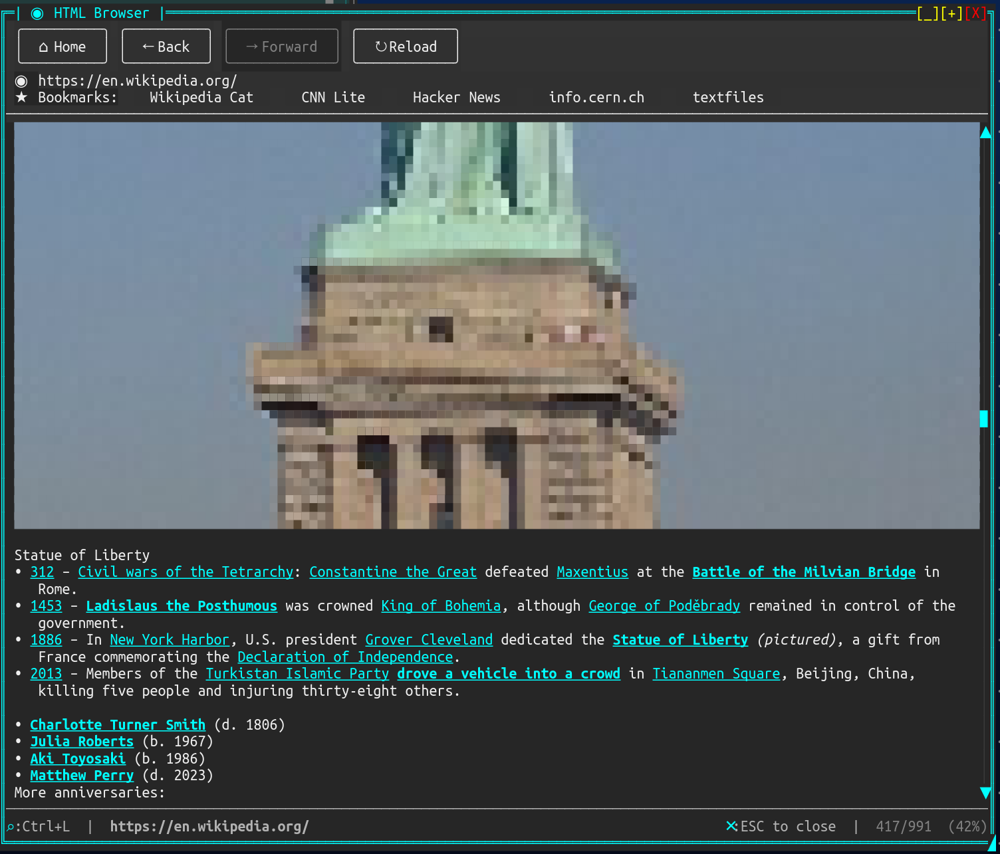

# HtmlControl

Render real HTML content in the terminal with scrolling, link navigation, and inline images.

<!-- gallery -->




## Overview

HtmlControl parses and renders HTML content using the AngleSharp HTML parser, displaying it with colors, text formatting, block layout, tables, lists, images (via half-block rendering), and interactive link navigation. It supports both inline HTML content and loading from URLs with progressive image loading.

## Properties

| Property | Type | Default | Description |
|----------|------|---------|-------------|
| `ForegroundColor` | `Color` | Theme default | Default text color |
| `BackgroundColor` | `Color` | Theme default | Background color |
| `LinkColor` | `Color` | Cyan | Color for unvisited links |
| `VisitedLinkColor` | `Color` | Purple | Color for visited links |
| `ShowImages` | `bool` | `false` | Enable half-block image rendering |
| `UsePageBackground` | `bool` | `false` | Let a page paint its own background |
| `ShowBulletPoints` | `bool` | `true` | Show bullet characters for `<ul>` lists |
| `TabSize` | `int` | `4` | Tab stop width in characters |
| `BlockSpacing` | `int` | `1` | Blank lines between block elements |
| `ScrollbarVisibility` | `ScrollbarVisibility` | `Auto` | When to show the vertical scrollbar |
| `LoadingText` | `string` | `"Loading..."` | Text shown during URL loading |
| `ScrollOffset` | `int` | `0` | Current vertical scroll position |
| `ContentHeight` | `int` | (read-only) | Total height of rendered content |
| `IsLoading` | `bool` | (read-only) | Whether a URL is currently loading |
| `LoadingStatus` | `string?` | (read-only) | Current loading phase description |
| `CurrentUrl` | `string?` | (read-only) | URL of the currently loaded page |
| `RawHtml` | `string?` | (read-only) | The raw HTML source |
| `MouseWheelScrollSpeed` | `int` | `ControlDefaults.DefaultScrollWheelLines` (1) | Lines scrolled per mouse wheel tick; values below 1 clamp to 1 |
| `IsEnabled` | `bool` | `true` | Whether the control accepts input |

## Events

| Event | Arguments | Description |
|-------|-----------|-------------|
| `LinkClicked` | `LinkClickedEventArgs(Url, Text, Mouse?)` | A link was activated (click or Enter) |
| `LinkHover` | `LinkHoverEventArgs` | Mouse moved over a link |
| `ContentLoaded` | `EventArgs` | HTML content was parsed and laid out |
| `LoadingCompleted` | `EventArgs` | URL loading and image loading finished |
| `LoadError` | `LoadErrorEventArgs` | An error occurred during URL loading |
| `MouseClick` | `MouseEventArgs` | Non-link area was clicked |
| `MouseRightClick` | `MouseEventArgs` | Right-click on the control |

## Creating HtmlControl

### Using Builder (Recommended)

```csharp
var html = Controls.Html()
    .WithContent("<h1>Hello World</h1><p>This is <b>bold</b> and <em>italic</em>.</p>")
    .WithLinkColor(Color.Cyan1)
    .WithShowImages(true)
    .WithScrollbarVisibility(ScrollbarVisibility.Auto)
    .WithMouseWheelScrollSpeed(3)
    .OnLinkClicked((sender, e) => Console.WriteLine($"Clicked: {e.Url}"))
    .Fill()
    .Build();

window.AddControl(html);
```

`WithMouseWheelScrollSpeed(int speed)` sets how many lines scroll per wheel notch (values below 1
clamp to 1). It defaults to `ControlDefaults.DefaultScrollWheelLines`, so setting that once at
startup changes the wheel step for every control that hasn't overridden it:

```csharp
// Change the wheel step everywhere, once at startup:
ControlDefaults.DefaultScrollWheelLines = 3;
```

### Using Constructor

```csharp
var html = new HtmlControl();
html.SetContent("<h1>Hello</h1><p>World</p>");
html.LinkClicked += (sender, e) => NavigateTo(e.Url);
window.AddControl(html);
```

### Loading from URL

```csharp
var html = Controls.Html()
    .WithShowImages(true)
    .Fill()
    .Build();

window.AddControl(html);

// Load asynchronously — shows loading banner while fetching
await html.LoadUrlAsync("https://example.com");
```

### Loading with Base URL

```csharp
// Set content with a base URL for resolving relative links and images
html.SetContent(htmlString, "https://example.com/page/");
```

### Loading a local page

```csharp
// file: URLs work for pages and images alike; a relative src on the page
// resolves against the folder the page lives in
await html.LoadUrlAsync("file:///home/me/saved/article.html");
```

## Keyboard Support

| Key | Action |
|-----|--------|
| `Up Arrow` | Scroll up one line |
| `Down Arrow` | Scroll down one line |
| `Page Up` | Scroll up one viewport |
| `Page Down` | Scroll down one viewport |
| `Home` | Scroll to top |
| `End` | Scroll to bottom |
| `Tab` | Focus next link |
| `Shift+Tab` | Focus previous link |
| `Enter` | Activate focused link (fires `LinkClicked`) |
| `Ctrl+C` | Copy the selected text (see Selecting and copying) |

## Mouse Support

| Action | Result |
|--------|--------|
| Click on link | Fires `LinkClicked` event |
| Drag across text | Selects it (see Selecting and copying) |
| Click on scrollbar | Scroll to position |
| Drag scrollbar thumb | Smooth scrolling |
| Mouse wheel | Scroll up/down |
| Hover over link | Fires `LinkHover`, brightens link text |
| Right-click | Fires `MouseRightClick` |

## Selecting and copying

Drag across the page to select text, and press `Ctrl+C` to copy it. A press
that does not move is a click and follows the link it landed on, exactly as
before; a press that moves is a drag and selects. That is how a browser
behaves, and it means selection costs the control nothing it already did.

**Copied text is what the document said, not what the screen showed.** A
paragraph laid out at eighty columns is a dozen screen lines, and copying those
verbatim would put a hard newline every eighty characters through text the
author wrote as one paragraph. A break the author wrote - a `<br>`, the end of
a paragraph, a newline in a code block - survives; a break the viewport
imposed does not.

Dragging selects within what is on screen: the page does not scroll to follow a
drag past the top or bottom edge, so selecting more than one screenful with the
mouse is not possible yet.

Two things do not copy:

- **A rendered picture.** Its cells are pixels rather than characters, and its
  alt text is not kept once the image arrives, so a picture contributes nothing
  and the text joins across it.
- **Table structure.** A row copies as it renders, borders included. Cell
  boundaries are gone by the time a row becomes a line, and recovering them
  would cost more than it returns.

### A note for existing users

`EnableSelection` defaults to **`true`**, which differs from `MarkupControl`,
where selection is opt-in. This control is a reading surface whose whole
purpose is displaying prose, and a reader who cannot copy from it will conclude
the feature is missing rather than look for a switch.

It does change left-button handling: with selection live, the control consumes
presses it previously let through. Click-to-follow-link is unaffected, so for
anyone not dragging the visible behaviour is the same. If it does not suit your
application, `EnableSelection = false` restores the previous handling exactly.

| Property | Type | Default | Description |
|----------|------|---------|-------------|
| `EnableSelection` | `bool` | `true` | Whether dragging selects text |
| `SelectionForegroundColor` | `Color?` | `null` | Foreground for selected cells |
| `SelectionBackgroundColor` | `Color?` | `null` | Background for selected cells |
| `CopyEnabled` | `bool` | `true` | Whether the copy key copies |
| `CopyKey` | `ConsoleKey` | `C` | The key that copies |
| `CopyModifiers` | `ConsoleModifiers` | `Control` | Modifiers for the copy key |

`HtmlControl` implements `ISelectableControl`, so the window's `SelectionManager`
coordinates it with any other selectable control: starting a selection in one
clears the others.

```csharp
var html = HtmlBuilder.Create()
    .WithContent(article)
    .Build();

html.SelectionChanged += (s, text) => status.SetContent($"{text.Length} characters selected");
```

## Focus Behavior

HtmlControl implements `IFocusableControl` and `IInteractiveControl`:

- **Tab focus**: Control receives focus via Tab key navigation
- **Mouse focus**: Clicking anywhere on the control (including scrollbar) sets focus
- **Visual indicator**: Scrollbar thumb turns cyan when focused
- **Link highlight**: Focused link is shown with inverted colors (foreground/background swapped)
- **Multi-line links**: Links spanning multiple lines are treated as a single Tab stop; all segments highlight together

## Supported HTML Elements

### Block Elements
`<h1>`–`<h6>`, `<p>`, `<div>`, `<blockquote>`, `<pre>`, `<code>`, `<hr>`, `<br>`, `<table>`, `<ul>`, `<ol>`, `<li>`, `<dl>`, `<dt>`, `<dd>`, `<details>`, `<summary>`, `<figure>`, `<figcaption>`

### Inline Elements
`<b>`, `<strong>`, `<i>`, `<em>`, `<u>`, `<s>`, `<strike>`, `<del>`, `<code>`, `<a>`, `<span>`, `<sub>`, `<sup>`, `<mark>`, `<small>`, `<abbr>`

### Tables
`<table>`, `<thead>`, `<tbody>`, `<tfoot>`, `<tr>`, `<th>`, `<td>` — with column width calculation, borders, and header styling.

### Images
`` — rendered using half-block pixel art when `ShowImages` is enabled. Supports PNG, JPEG, BMP, GIF and TGA (not TIFF). Progressive loading fetches and renders images in the background after initial text layout. An image that cannot be loaded shows its `alt` text.

#### How an image is sized

A declared pixel width is read as a **fraction of a nominal 700px content column**, and that fraction is spent on the columns available. So a 220px thumbnail takes about a third of the page, and the same image is wider in a wide window than in a narrow one.

| Declared | On a 120-column page | On a 60-column page |
|----------|----------------------|---------------------|
| `32px` | 5 columns | 3 columns |
| `220px` | 38 columns | 19 columns |
| `500px` | 86 columns | 43 columns |
| `700px` or more | full width | full width |

The frame is the **content column, not the whole window**. A browser window also holds a sidebar, margins and chrome; the text and pictures live in a narrower column inside it, and that column is what an author sizes a picture for. An encyclopedia serves its thumbnails at 250px for a column around 700px wide, a bit over a third of the text beside them.

A terminal renders none of that furniture, so its text runs the full width and the column *is* the line. Measuring those same 250px against a full 1024px window gave a picture about a quarter of a line that its own page gave over a third of, so every picture came out roughly half the size it reads at next to the same words.

This is a different question from what the page is *told* about its viewport, which is a separate 1024x768 reported to media queries and viewport-relative units. See `HtmlConstants.CssContentWidthPx` and `HtmlConstants.CssViewportWidthPx`.

There is no height cap. A tall image is a tall image and the document scrolls, exactly as in a browser; capping height to the viewport would also mean the same image rendered at different sizes in different window heights, so resizing would silently rewrite the page.

The width is taken from the first of: a stylesheet `width`, an inline `style="width:..."`, the HTML `width` attribute, or the image's own pixel width. A size written in CSS and the same size written as an attribute mean the same thing. An image is never wider than the page.

**A `width` attribute is reconciled against the pixels actually served.** Real pages get that attribute wrong in both directions at once: an encyclopedia article carries the original file's resolution on some images (`width="3640"` on a thumbnail served as 250 real pixels) and a stale display size on others (`width="135"` on that same file). Believed literally, those two neighbours render as a full-page photograph and a smudge. The served pixel width is the one number the page cannot be wrong about, so it decides. A **stylesheet** width is real layout intent, and is left alone: a page may legitimately show a 1600px photograph as a 200px inset.

A fixed pixels-per-column ratio cannot do this job, which is why one is not used: at 1:1 every image on a real page is wider than the terminal and so every image fills it, thumbnail and hero alike; at a fixed 8:1 a thumbnail is a sensible size on a wide terminal and most of a narrow one.

#### Linked images

An `` inside an `<a href>` is a link: clickable, hoverable, and a Tab stop, exactly like linked text. The whole picture is **one** target rather than one per rendered row, and it takes its place in the document's link order.

The focus and hover highlights invert or brighten a link's cells, which on a half-block image would scramble the picture: each cell carries one pixel in its foreground and another in its background. A linked picture is marked in the column beside it instead, so nothing of the image is overwritten.

When an image has not loaded, the `alt` text standing in for it carries the link too.

### Page colours

A page picks its colours for its own background, which a terminal rarely has. Every resolved foreground is held to a contrast floor against the surface it is actually drawn on, so a page's colour arrives exactly as asked whenever it can be read, and is lifted the shortest distance that makes it legible when it cannot. The hue is kept, so a dark red link comes back a readable red rather than the theme's accent.

Without this, Hacker News (`a:link { color:#000000 }`, chosen for its cream page) rendered every headline black on a dark terminal.

Set `UsePageBackground` to let a page paint its own surface as well, from `bgcolor` or CSS, looked for on the body and down a single-child wrapper chain — which is where a classic page puts it (`body > center > table`). It is off by default because the control usually sits inside a themed window. The contrast floor applies either way, so neither setting can produce unreadable text:

```csharp
// Toggles live - setting it re-runs layout on the page already on screen
html.UsePageBackground = true;
```

A table that declares `border="0"` is laid out without box-drawing lines, since that attribute means the table is positioning things rather than presenting data. Its columns still align. A table that declares a border, or says nothing, keeps its lines.

### Local files

`file:` URLs work for both pages and images, as they do in a browser:

```csharp
await html.LoadUrlAsync("file:///home/me/notes/page.html");
```

A relative `src` on such a page resolves against the page's own folder, so a document saved to disk opens with its pictures intact.

**Same-origin rule.** A page fetched over `http`/`https` may **not** load `file:` images; those render as alt text. Without that rule any site could name a path on the machine and have the result rendered on screen. Content supplied directly through `SetContent` has no remote origin, so it may reference local files freely.

## Examples

### Simple HTML Content

```csharp
var html = Controls.Html()
    .WithContent("""
        <h1>Welcome</h1>
        <p>This is a paragraph with <b>bold</b> and <em>italic</em> text.</p>
        <ul>
            <li>Item one</li>
            <li>Item two</li>
            <li>Item three</li>
        </ul>
    """)
    .Fill()
    .Build();
```

### Web Browser with Navigation

```csharp
var html = Controls.Html()
    .WithShowImages(true)
    .OnLinkClicked(async (sender, e) =>
    {
        var control = (HtmlControl)sender!;
        await control.LoadUrlAsync(e.Url);
    })
    .Fill()
    .Build();

await html.LoadUrlAsync("https://en.wikipedia.org/wiki/Main_Page");
```

### Email Viewer

```csharp
var html = Controls.Html()
    .WithShowImages(false)  // Don't load remote images in emails
    .WithLinkColor(Color.Blue)
    .WithBackgroundColor(Color.White)
    .WithForegroundColor(Color.Black)
    .Fill()
    .Build();

html.SetContent(emailHtmlBody, emailBaseUrl);
```

### Link Hover Status Bar

```csharp
var statusLabel = Controls.Markup().Build();

var html = Controls.Html()
    .OnLinkHover((sender, e) =>
    {
        statusLabel.SetContent(new List<string>
        {
            e.Url != null ? $"[dim]{e.Url}[/]" : ""
        });
    })
    .Fill()
    .Build();
```

### Custom Colors and Styling

```csharp
var html = Controls.Html()
    .WithContent("<h1>Dark Theme</h1><p>Content here</p>")
    .WithForegroundColor(new Color(200, 200, 200))
    .WithBackgroundColor(new Color(30, 30, 30))
    .WithLinkColor(Color.Cyan1)
    .WithVisitedLinkColor(new Color(180, 130, 255))
    .WithBlockSpacing(2)
    .Fill()
    .Build();
```

## Performance Notes

- **DOM caching**: The HTML parser caches the parsed DOM document. Width-only changes (e.g., window resize) skip re-parsing and only re-flow the layout.
- **Resize debouncing**: During rapid resize, relayout is debounced (150ms) to keep the UI responsive. Content renders at the previous width until resize settles.
- **Progressive image loading**: When `ShowImages` is enabled, text content renders immediately. Images load in the background and are progressively committed to the layout.
- **Large documents**: For very large HTML documents, consider setting an explicit `Height` to avoid measuring the full document height.

## Best Practices

- Use `ShowImages = true` only when image content is expected — it enables background HTTP fetches
- Handle `LinkClicked` to implement navigation; the control does not navigate automatically
- Use `SetContent(html, baseUrl)` when HTML contains relative URLs
- For email rendering, disable images and set explicit colors for readability
- Use `LoadUrlAsync` with cancellation support for user-navigatable content
- The control consumes Tab key for link navigation — use `Shift+Tab` to move focus away

## NativeAOT

`HtmlControl` works under NativeAOT — a published native binary renders HTML (including CSS `calc()`) correctly, verified by the library's AOT smoke test.

The one caveat: its dependency **AngleSharp.Css** evaluates CSS `calc()` via reflection, so AOT-publishing an app that uses `HtmlControl` surfaces 4 `IL2072` trim **warnings** (from AngleSharp.Css, not SharpConsoleUI). They're an analysis limitation, not a runtime failure. If your build treats trim warnings as errors, see **[NativeAOT Compatibility → HtmlControl caveat](../AOT.md#htmlcontrol-caveat)** for the scoped `.csproj` fix. If you don't use `HtmlControl`, the rest of the library is AOT-clean with no action needed.

## See Also

- [MarkupControl](MarkupControl.md) — for simple formatted text without HTML parsing
- [Image Rendering](../IMAGE_RENDERING.md) — for standalone image display
- [Compositor Effects](../COMPOSITOR_EFFECTS.md) — for post-processing visual effects
- [Controls Reference](../CONTROLS.md) — complete control listing

[Back to Controls](../CONTROLS.md) | [Back to Main Documentation](https://nickprotop.github.io/ConsoleEx/)
