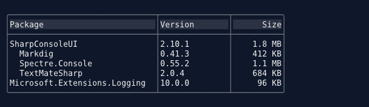

# TreeTableControl

A table whose rows nest: rows hold rows of their own, shown indented under them in the tree column and expanded or collapsed in place.

<!-- gallery -->




## Overview

TreeTableControl is a [TableControl](TableControl.md) whose rows form a hierarchy: features with their stories and tasks, folders with their files, accounts with their sub-accounts. Each row is a `TreeTableRow`, which has cells like any `TableRow` plus a parent, children and an expansion state. The tree column draws, in front of each value, the guide lines to the row's parent and an expander, `[-]` or `[+]`, in the same guide styles as [TreeControl](TreeControl.md).

Because it is a `TableControl`, everything a table does it does too: columns and their widths, selection, multi-select, cell navigation, inline editing, scrollbars, colors, the builder settings. Sorting and filtering follow the hierarchy: a sort orders each row's children among themselves, and a filter shows each match together with the rows above it. [Checkboxes](#checkboxes) know about the hierarchy as well, and are the one place the tree does not simply inherit the table's behaviour: checking is separate from selection here, and a checked row can carry the rows under it.

```
┌──────────────────────┬─────┐
│Title                 │Owner│
├──────────────────────┼─────┤
│[-] Feature: Login    │Pat  │
│├─ [-] Story: Form    │Bo   │
││  ├─     Task: Layout│Bo   │
││  └─     Task: Checks│Cy   │
│└─     Story: Reset   │Pat  │
│[+] Feature: Reports  │Di   │
└──────────────────────┴─────┘
```

See also: [TableControl](TableControl.md), [TreeControl](TreeControl.md)

## Quick Start

```csharp
var builder = Controls.TreeTable()
    .AddColumn("Title")
    .AddColumn("Owner")
    .Interactive()
    .WithSorting()
    .WithFiltering();

var login = builder.AddRootRow("Feature: Login", "Pat");
var form = login.AddChild("Story: Form", "Bo");
form.AddChild("Task: Layout", "Bo");
form.AddChild("Task: Checks", "Cy");
login.AddChild("Story: Reset", "Pat");

var table = builder.Build();
window.AddControl(table);
```

`AddRootRow` with cell text returns the new row, and `AddChild` returns the new child, so a hierarchy is built by capturing the rows to nest under.

## Rows and the Hierarchy

A `TreeTableRow` belongs to one parent and one table at a time. Rows can be built up detached, a whole subtree at a time, and added to a table in one step; once in a table, changes made through the row are applied to the table at once.

```csharp
// Build a subtree detached, then add it
var reports = new TreeTableRow("Feature: Reports", "Di");
reports.AddChild("Story: Export", "Di");
table.AddRootRow(reports);           // or InsertRootRow(index, reports)

// Change it in place
var export = reports.Children[0];
export.AddChild("Task: CSV", "Eve");
reports.InsertChild(0, new TreeTableRow("Story: Charts", "Cy"));
reports.RemoveChild(export);          // removes its subtree too

// Move a row, keeping it the same row: its selection, expansion and tag go with it
table.MoveRow(form, newParent: reports, index: 0);
table.MoveRow(form, newParent: null, index: 0);  // make it a root
```

Adding a row that already has a parent or is already in a table throws `InvalidOperationException`, and so does nesting a row under itself or one of its descendants.

### Batching

Every change recomputes the displayed rows once, which is right for one change and wasteful for a thousand. `BatchUpdate` makes any number of changes one recompute:

```csharp
table.BatchUpdate(() =>
{
    foreach (var item in workItems)
        AddWithChildren(table, item);
});
```

Batches nest; only the outermost one ends the batch. Until it ends, `Rows`, `RowCount` and the display show the table as it was before. Building a subtree detached and adding it in one step is cheaper still.

## The Inherited Table API

Code written against a `TableControl` works on a tree table. Its inherited members keep their meaning, read in terms of the hierarchy:

| Inherited member | On a tree table |
|------------------|-----------------|
| `Rows`, `GetRow`, `GetCell`, `UpdateCell`, `GetRowTagAt` | Every row, depth-first in sibling order, whatever is expanded or filtered |
| `RowCount`, `SelectedRowIndex`, the selection and row events | The rows displayed |
| `AddRow`, `AddRows` | Append roots; a `TreeTableRow` brings its subtree, a plain `TableRow` is a root without children, cell text becomes a `TreeTableRow` |
| `InsertRow(i, ...)`, `InsertRows` | Insert roots at the first root at or after `Rows[i]`, so a flat tree table inserts exactly as a table does |
| `RemoveRow(i)` | Removes `Rows[i]` with the rows nested under it |
| `ClearRows`, `SetData` | Clear and replace the roots |
| `SortByColumn`, `ClearSort` | Sort each row's children among themselves |
| `ApplyFilter`, `FilterByColumn`, `ClearFilter` | Filter by the hierarchy, see [Filtering](#filtering) |
| `DataSource` | Makes the table flat, exactly as a table; the tree members throw `InvalidOperationException` while one is set |

A tree table without nested rows draws, sorts, filters and selects exactly as a `TableControl`.

## Expanding and Collapsing

```csharp
table.Expand(row);            // true when it changed
table.Collapse(row);
table.Toggle(row);
table.ExpandSubtree(row);     // the row and every row under it
table.ExpandAll();
table.CollapseAll();
row.IsExpanded = false;       // the same, through the row

table.EnsureRowVisible(row);  // opens the rows above it and scrolls to it
table.SelectRow(row);         // the same, and selects it
```

Rows start expanded, as `TreeNode`s do. `TreeTableRow.IsExpanded` is the row's own, lasting state. `IsRowExpanded(row)` says whether the row is open in what is displayed, which differs only while filtered.

A cursor whose row a collapse hides moves to the nearest row above it still displayed.

## Sorting

Sorting a hierarchy as a flat list would tear rows away from their parents. `SortByColumn` instead orders each row's children among themselves, and the roots among themselves, so every row stays under its parent. Siblings are compared by the table's own rules, so a column's `CustomComparer` and the table's `CustomRowComparer` mean what they mean to a table; rows that compare equal keep the order they were added in, in either direction. `ClearSort` restores that order, and a row added while sorted takes its sorted place among its siblings.

## Filtering

Filtering a hierarchy as a flat list would show matches out of context, and miss the rows inside collapsed parents. A tree table searches every row, collapsed or not, with the table's own [filter syntax](TableControl.md#filter-syntax), and shows each match together with every row above it:

```csharp
table.ApplyFilter("checks");
```

```
┌──────────────────────┬─────┐
│Title                 │Owner│
├──────────────────────┼─────┤
│[-] Feature: Login    │Pat  │
│└─ [-] Story: Form    │Bo   │
│   └─     Task: Checks│Cy   │
└──────────────────────┴─────┘
```

- The rows above a match are open in the filtered view, whatever their own state.
- A match's children that do not match stay hidden. Set `FilterIncludesDescendants` to show every row under a match, matching or not: finding a feature then shows all its stories.
- A row whose children are all filtered out shows no expander.
- Sorting a filtered table orders the siblings shown.

Opening and closing rows while filtered changes only the filtered view: `TreeTableRow.IsExpanded` keeps the row's own state, and clearing or changing the filter brings the hierarchy back as it was.

## Loading Children on Demand

A row with `HasUnrealizedChildren` shows an expander before it has children. Add them from `RowExpansionChanging` when the row is first expanded; children added there are displayed together with the expansion, in the same recompute:

```csharp
var table = Controls.TreeTable()
    .AddColumn("Folder")
    .OnRowExpansionChanging((sender, e) =>
    {
        if (!e.IsExpanded || !e.Row.HasUnrealizedChildren || e.Row.Tag is not string path)
            return;

        foreach (var dir in Directory.GetDirectories(path))
        {
            e.Row.AddChild(new TreeTableRow(MarkupParser.Escape(Path.GetFileName(dir)))
            {
                Tag = dir,
                IsExpanded = false,
                HasUnrealizedChildren = true,
            });
        }
        e.Row.HasUnrealizedChildren = false;
    })
    .Build();

table.AddRootRow(new TreeTableRow("Projects")
{
    Tag = projectsPath,
    IsExpanded = false,
    HasUnrealizedChildren = true,
});
```

## Selection

The selection stays on its rows across every change: a sort, a filter cleared, rows added, moved or removed elsewhere.

When the selected row is removed, the cursor goes to its next sibling still displayed, else the previous one, else the nearest row above it, rather than to whatever row followed the removed subtree. Siblings are taken in the order they were displayed, so in a sorted view the cursor goes to the row shown below.

## Checkboxes

With `WithCheckboxMode()` the tree draws a checkbox on each row. Checking is separate from
selection here, unlike a flat table where the two are the same thing: checking answers "which rows
do I act on", selection answers "where is the cursor", and a batch operation needs the first
without disturbing the second.

```csharp
var table = Controls.TreeTable()
    .AddColumn("Item")
    .WithCheckboxMode()
    .WithCascadingChecks()        // a parent carries its subtree
    .WithoutParentCheckboxes()    // groups are structure, leaves are the targets
    .Build();

foreach (var row in table.GetCheckedLeaves())
    Install(row.Tag);
```

`GetCheckState` returns a `TableCheckState`, which is `Unchecked`, `Checked`, or `Indeterminate`
for a row whose descendants disagree. `TableRow.IsChecked` stays a `bool` and reads as
`state == Checked`, so code that only cares whether a row is checked needs no change.

**Cascading.** Off by default, which leaves every checkbox independent. On, checking a row checks
every row under it, and each row above shows what its own children say: checked when they all are,
unchecked when none are, and `[-]` when they disagree. That third state is only ever computed, so
there is no way to assign it, and a row with no children can never hold it.

**Hiding a parent's checkbox.** `ShowParentCheckboxes = false` blanks the checkbox on rows that
have children; the rows keep every column, and only that cell is empty. `TreeTableRow.ShowCheckbox`
overrides it for one row, with `null` meaning follow the control.

Hidden means not drawn and not clickable. It does not mean unsettable: `IsChecked` still works from
code, the row still appears in `GetCheckedRows()` when checked, and it still takes part in the
cascade. That combination is useful on its own - cascade on with parent checkboxes hidden lets the
user check leaves while the application reads the parents to ask "is this whole group selected?".

**Knowing when it changes.** `CheckChanged` is raised once for each row whose state actually
changed, a cascade included. The selection events say nothing about checking here, since the two
are separate, so this is what keeps a count or a toolbar in step without walking the tree.

**When the hierarchy changes.** Under cascade, a row's state is derived from the rows under it, so
adding, removing, moving or clearing rows settles the parents involved rather than leaving one
reporting a state its own children contradict. Removing the one unchecked child of an
otherwise-checked parent makes that parent checked; adding an unchecked child to a checked parent
makes it `[-]`; a moved subtree settles both the parent it left and the one it joined. The same
holds whichever API makes the change: the tree's own `AddChild` and `RemoveChild`, or the table's
`RemoveRow`, `ClearRows` and `MoveRow`.

A row that loses every child becomes a leaf, and a leaf cannot be `[-]`, so one left in that state
settles to unchecked - nothing under it was ever confirmed. Turning `CascadeChecks` on settles
every parent at that moment, since nothing was deriving them while it was off.

**Reading what is checked.** `GetCheckedRows()` reports every checked row, parents included.
`GetCheckedLeaves()` reports only the rows with nothing under them, which is what a batch caller
wants: group rows usually carry no record of their own, and a caller filtering them out by tag type
gets silence when a user checks a group.

Both include rows that are collapsed or filtered out of view. A check is an instruction, not a view
state: a user who checks a group and then collapses it still means those rows. Show a count from
these methods rather than from the visible rows, so the number does not change when the user folds
something away.

## Keyboard Support

| Key | Action |
|-----|--------|
| **Right Arrow** | Expand the selected row, or move to its first child once it is open |
| **Left Arrow** | Collapse the selected row, or move to its parent once it is closed |
| **Space** | Check the selected row in checkbox mode, otherwise toggle it open or closed |
| **+** | Expand the selected row (main keyboard or numeric pad) |
| **-** | Collapse the selected row |
| **\*** | Expand the selected row and every row under it |

Every other key is the table's, see [TableControl](TableControl.md#keyboard-support). The table keeps the keys it already gives a meaning to: with `CellNavigationEnabled`, Left and Right move between cells; with `MultiSelectEnabled`, Space selects rows. Keys held with Ctrl or Alt are left to the application.

In checkbox mode Space checks at every depth rather than opening a row, so the key does not change
meaning as the cursor moves between a parent and a leaf. Right and Left still open and close.

## Mouse Support

| Action | Result |
|--------|--------|
| **Left Click (expander)** | Select and toggle the row |
| **Left Click (checkbox)** | Check or uncheck the row, without moving the selection |
| **Left Click (elsewhere)** | Select the row, as in a table |
| **Double Click (value)** | Activate the row (`RowActivated`), as in a table |

Two quick clicks on an expander toggle the row twice rather than activating it. Everything else is the table's, see [TableControl](TableControl.md#mouse-support).

## Properties

| Property | Type | Default | Description |
|----------|------|---------|-------------|
| `RootRows` | `IReadOnlyList<TableRow>` | Empty | The rows at the top of the hierarchy (snapshot) |
| `Guide` | `TreeGuide` | `Line` | Guide line style (`Line`, `Ascii`, `DoubleLine`, `BoldLine`) |
| `Indent` | `string` | `"  "` | What follows each ancestor level's guide line, drawn as text |
| `TreeColumnIndex` | `int` | `0` | The column the guides and expanders are drawn in |
| `FilterIncludesDescendants` | `bool` | `false` | Whether a filter shows every row under a match |
| `CascadeChecks` | `bool` | `false` | Whether checking a row carries the rows under it, and parents show what their children say |
| `ShowParentCheckboxes` | `bool` | `true` | Whether rows that have children draw a checkbox |

Every `TableControl` property applies as well.

### TreeTableRow

| Member | Type | Description |
|--------|------|-------------|
| `Children` | `IReadOnlyList<TreeTableRow>` | The rows nested directly under this one (live, read-only) |
| `Parent` | `TreeTableRow?` | The row this one is nested under, or null |
| `Depth` | `int` | How many rows this one is nested under: 0 for a root |
| `IsExpanded` | `bool` | The row's own expansion state; default `true` |
| `HasUnrealizedChildren` | `bool` | Shows an expander before children are loaded; default `false` |
| `ShowCheckbox` | `bool?` | Whether this row draws a checkbox, overriding the control; `null` follows `ShowParentCheckboxes` |
| `IsChecked` | `bool` | The row's check state; reads and writes the control's, so it works on any row the tree holds |
| `AddChild(params string[])`, `AddChild(TreeTableRow)` | `TreeTableRow` | Adds a last child and returns it |
| `InsertChild(int, TreeTableRow)` | `TreeTableRow` | Inserts a child and returns it |
| `RemoveChild(TreeTableRow)` | `bool` | Removes a child with its subtree |
| `ClearChildren()` | | Removes every child |

## Methods

| Method | Description |
|--------|-------------|
| `AddRootRow(params string[])` | Adds a root row and returns it |
| `AddRootRow(TreeTableRow)` | Adds a row with its subtree as the last root |
| `InsertRootRow(int, TreeTableRow)` | Inserts a row with its subtree among the roots |
| `RemoveRow(TableRow)` | Removes a row at any depth with its subtree; false if not in the table |
| `MoveRow(TableRow, TreeTableRow?, int)` | Moves a row with its subtree under another parent, or among the roots |
| `BatchUpdate(Action)` | Makes any number of changes one recompute |
| `Expand`, `Collapse`, `Toggle` | Open or close a row; true when it changed |
| `ExpandSubtree(TreeTableRow)` | Opens a row and every row under it |
| `ExpandAll()`, `CollapseAll()` | Open or close every row |
| `IsRowExpanded(TreeTableRow)` | Whether a row is open in what is displayed |
| `EnsureRowVisible(TableRow)` | Opens the rows above a row and scrolls to it |
| `SelectRow(TableRow)` | Makes a row visible and selects it |
| `GetParentRow(TableRow)` | The row a row is nested under |
| `GetDepth(TableRow)` | 0 for a root, -1 for a row not in the table |
| `FindRowByTag(object)` | The first row, depth-first, with a matching `Tag` |
| `GetCheckState(TableRow)` | A row's `TableCheckState`: `Unchecked`, `Checked` or `Indeterminate` |
| `SetCheckState(TableRow, bool)` | Checks or unchecks a row, cascading when `CascadeChecks` is on |
| `GetCheckedLeaves()` | The checked rows with nothing under them, collapsed and filtered ones included |
| `IsCheckboxVisible(TableRow)` | Whether a row draws a checkbox the user can click |

## Events

| Event | Arguments | Description |
|-------|-----------|-------------|
| `RowExpansionChanging` | `EventHandler<TreeTableRowExpansionChangingEventArgs>` | Before a row is expanded or collapsed; set `Cancel` to keep it as it is |
| `RowExpansionChanged` | `EventHandler<TreeTableRowExpansionEventArgs>` | After a row was expanded or collapsed, once the rows displayed show it |
| `RowExpansionChangedAsync` | `AsyncEventHandler<TreeTableRowExpansionEventArgs>` | Async counterpart of `RowExpansionChanged` |
| `CheckChanged` | `EventHandler<TableRow>` | After a row's check state changed, once per row a cascade touched |

The arguments name the `Row`, whether it `IsExpanded` after the change, and whether the change `IsFilteredView`: made while filtered, to the filtered view only. Every way of opening and closing a row raises them: the methods, setting `IsExpanded`, the keys and the expander. A bulk change raises them for each row and leaves a cancelled row out; in a `BatchUpdate`, `RowExpansionChanged` waits for the batch to end. `RowExpansionChanged` follows the selection events the change caused.

Selection and activation come from the table: `SelectedRowChanged`, `SelectedRowItemChanged`, `RowActivated` and the rest.

## Builder API

Create a builder with `Controls.TreeTable()` or `TreeTableControl.Create()`. Every [TableControl builder method](TableControl.md#builder-methods) is available in the same chain; the rows it adds are roots.

```csharp
.AddRootRow(TreeTableRow row)              // Add a row with its subtree (returns builder)
.AddRootRow("cell", "cell")                // Create + add a row (returns the TreeTableRow)
.WithGuide(TreeGuide.Line)                 // Guide line style
.WithIndent("  ")                          // Text after each ancestor level's guide
.WithTreeColumn(1)                         // Column the hierarchy is drawn in
.WithFilterIncludingDescendants()          // Show every row under a filter match
.WithCascadingChecks()                     // A checked row carries the rows under it
.WithoutParentCheckboxes()                 // Rows with children draw no checkbox
.OnRowExpansionChanging((sender, e) => { ... })
.OnRowExpansionChanged((sender, e) => { ... })
```

## Binding to Items

`BindItems` (namespace `SharpConsoleUI.DataBinding`) shows a hierarchy of view models, one row per item, and keeps the rows in step as the items and their `ObservableCollection`s change: added, removed, moved and replaced items, item property changes, and expansion in both directions. See [Data Binding](../BINDING.md#binding-a-tree-table-to-items).

```csharp
table.BindItems(backlog.Roots,
    childrenOf: item => item.Children,
    cellsOf: item => [item.Title, item.Owner]);
```

## Extending TreeTableControl

TreeTableControl is built on the [extension points of TableControl](TableControl.md#extending-tablecontrol) and adds its own. Each is protected and runs on the UI thread.

| Member | What it is for |
|--------|----------------|
| `CreateTreeRow(IReadOnlyList<string>)` | The row created for cell text added through the table: return a row type of your own |
| `IsFilterMatch(TableRow, CompoundFilterExpression)` | Whether a row matches the filter by itself; default the table's own rules |
| `CompareSiblings(TableRow, TableRow, int, SortDirection)` | The order of two siblings for a sort; default the table's own comparison |
| `GetGuideMarkup(in TreeTableRowContext)` | The guide lines in front of a row |
| `GetExpanderMarkup(in TreeTableRowContext)` | The expander after the guides; its width is the span a click toggles |
| `TryHandleKey`, `TryHandleClick` | The tree's keys and expander click; override and call the base to add your own |

`TreeTableRowContext` describes a row as displayed: `Row`, `DataRowIndex`, `Depth`, `HasChildren`, `IsExpanded`, `IsLastSibling`, `ShowsExpanderGutter`, `Guide`, `Indent`, and `IsLastSiblingAtDepth(depth)` for drawing an ancestor's continuation line.

```csharp
// Folders before files, then by name
class FileTable : TreeTableControl
{
    protected override int CompareSiblings(TableRow x, TableRow y, int column, SortDirection direction)
    {
        bool xFolder = x is TreeTableRow { HasUnrealizedChildren: true } or TreeTableRow { Children.Count: > 0 };
        bool yFolder = y is TreeTableRow { HasUnrealizedChildren: true } or TreeTableRow { Children.Count: > 0 };
        if (xFolder != yFolder)
            return xFolder ? -1 : 1;
        return base.CompareSiblings(x, y, column, direction);
    }

    // A two-cell expander instead of [-] and [+]; a click on it still toggles the row
    protected override string GetExpanderMarkup(in TreeTableRowContext context)
    {
        if (context.HasChildren)
            return context.IsExpanded ? "v " : "> ";
        return context.ShowsExpanderGutter ? "  " : string.Empty;
    }
}
```

## Threading

Change the hierarchy on the UI thread, as with any control; from a background thread, marshal through `windowSystem.EnqueueOnUIThread`. The display is computed from a snapshot of the hierarchy taken when it was last handed to the table, so painting never shows a batch half done, and the events are raised outside the table's lock, so a handler can change the table.

`CheckChanged` is raised outside the lock too, so a handler may read or change check state without deadlocking; a handler that checks another row during a cascade settles rather than corrupting it, since the cascade applies states rather than toggling them. `GetCheckedRows()` and `GetCheckedLeaves()` take the table's lock, so they answer safely from any thread.

## See Also

- [TableControl](TableControl.md) - The table it extends: columns, selection, editing, filtering
- [TreeControl](TreeControl.md) - For a hierarchy shown in a single column
- [Controls Reference](../CONTROLS.md) - All controls overview

---

[Back to Controls](../CONTROLS.md) | [Back to Main Documentation](https://nickprotop.github.io/ConsoleEx/)
